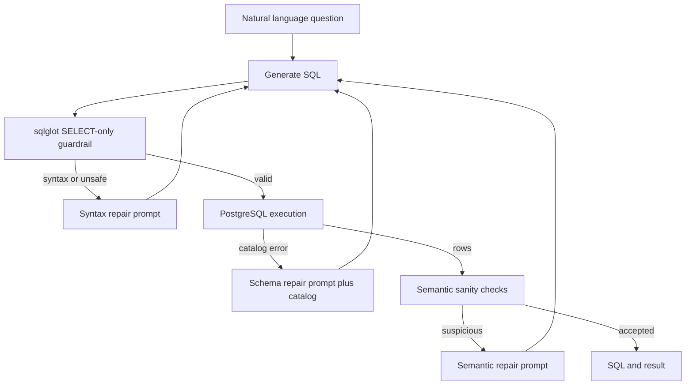

# Self-Correcting Text-to-SQL Engine

A deliberately small, inspectable PostgreSQL analytics agent. It does not trust an LLM query simply because PostgreSQL accepts it: every attempt passes an AST guardrail, schema/execution feedback, and semantic sanity checks before it is returned.

## What it does



The loop has a hard maximum of three attempts. Each rejection is recorded as `syntax`, `schema`, or `semantic`; repair prompts carry only the diagnostic context relevant to that failure class.

## Run

```bash
cp .env.example .env
docker compose up --build
curl -X POST http://localhost:8000/api/query \
  -H 'content-type: application/json' \
  -d '{"question":"Show me all customers in New York"}'
```

Open `http://localhost:8000/docs` for the interactive API. The default `LLM_PROVIDER=deterministic` lets the stack run without a secret. Set `LLM_PROVIDER=openai` and `OPENAI_API_KEY` to use the configured, pinned `LLM_MODEL` instead.

## API contract

`POST /api/query` accepts `{ "question": "..." }` and returns:

```json
{"status":"success","final_sql":"SELECT ...","results":[],"iterations":1,"repair_history":[]}
```

`repair_history` entries contain `attempt`, `failure_type`, and `error_message`. A failed query still returns HTTP 200 because it is a completed, auditable pipeline outcome; unavailable database/provider infrastructure returns 503.

## Messy seeded schema

The compose database is seeded automatically from `scripts/seed_db.sql` with 120 customers, 600 orders, and 1,800 line items. It intentionally uses `customers.customer_id` versus `orders.cust_id`, permits `customers.region` to be NULL, and duplicates monetary information (`orders.total_amount` and line-item pricing) to create realistic ambiguity.

## Evaluation and tests

The 30-case evaluation set is at `data/eval_set.json`. Execute all three modes (zero-shot, syntax/schema repair, and full semantic repair) after startup:

```bash
docker compose exec api python scripts/evaluate.py
docker compose exec api pytest -q
```

The evaluator compares executed rows against the gold SQL (order-independent), writes `results/evaluation_metrics.json`, and reports execution accuracy, average iterations, and failure-class breakdown for every configuration.

## Safety boundary

`src/guardrails.py` uses `sqlglot` to parse exactly one PostgreSQL statement and permits only a `SELECT` AST (including SELECT-backed CTEs). Multiple statements and DDL/DML are rejected before the database wrapper is called. This is a read-only analytics sample, not a substitute for database roles, least privilege, statement timeouts, or tenant-level authorization in production.
